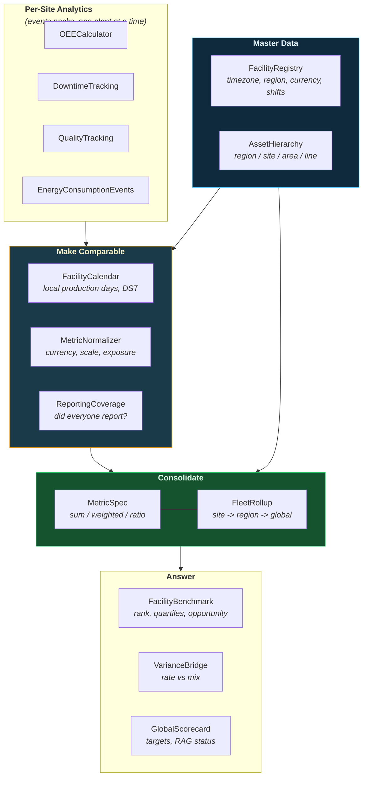

# Global Reporting Across Facilities

Consolidating production KPIs across plants, timezones and currencies — facility
master data, local production days, coverage checks, weighted rollups,
benchmarking, variance bridges and the management scorecard.

---

## Why a Separate Layer

Every other ts-shape pack answers a question about **one** asset: this line's OEE,
that station's scrap rate, this machine's downtime. A global operations function
asks different questions, and they break in different ways:

| Question | How it silently goes wrong |
|----------|---------------------------|
| What is the fleet OEE? | The unweighted mean of site OEEs reports a number no plant experienced. |
| How did yesterday go? | "Yesterday" is a different 24 hours in Stuttgart, Detroit and Shanghai — and 23 hours twice a year. |
| Which site drove the change? | The fleet rate fell while every plant improved, because volume shifted. |
| Is the number complete? | 34 of 37 plants reported; the total just looks low. |
| Which plant is most expensive? | Costs sit in three currencies at three scales. |

`ts_shape.reporting` is the layer that answers them. It is deliberately
**downstream** of the event packs: each site computes its own KPIs from raw
signals, and this layer consolidates the resulting KPI frames. It never touches
raw timeseries, so it works equally well on KPIs that arrived from an MES, a
data warehouse, or another ts-shape run.



Runnable end-to-end demo: [`examples/global_reporting_demo.py`](https://github.com/ts-shape/ts-shape/blob/main/examples/global_reporting_demo.py).

---

## The Input Frame

Everything in this layer consumes one shape: a **long KPI frame**, one row per
facility and period.

| Column | Meaning |
|--------|---------|
| `facility` | Site identifier, matching the registry |
| `period` | Reporting period (local day, week, month) |
| *metrics* | `parts_produced`, `oee_pct`, `scrap_cost`, … |
| *weights* | `planned_minutes`, `parts_produced`, … — the exposure a rate is weighted by |

---

## 1. Facility Master Data

```python
from ts_shape.reporting import Facility, FacilityRegistry

registry = FacilityRegistry([
    Facility("DE-STR", name="Stuttgart", timezone="Europe/Berlin",
             region="EMEA", country="DE", currency="EUR", capacity_per_day=1200),
    Facility("US-DTW", name="Detroit", timezone="America/Detroit",
             region="AMER", country="US", currency="USD",
             shifts={"day": ("07:00", "19:00"), "night": ("19:00", "07:00")}),
    Facility("CN-SHA", name="Shanghai", timezone="Asia/Shanghai",
             region="APAC", country="CN", currency="CNY"),
])

registry.validate()   # empty DataFrame == master data is sound
```

`validate()` is a gate, not decoration. It catches the master-data defects that
corrupt a report downstream: an unresolvable timezone, a missing region (the site
lands under `unassigned` in every regional view), a shift pattern that overlaps
(readings counted twice) or leaves a gap (readings counted nowhere).

Master data usually lives in a table already:

```python
registry = FacilityRegistry.from_frame(plants_df)      # facility, timezone, region, ...
registry.attach(kpi_df, columns=["region", "currency"])
```

---

## 2. Local Production Days

```python
from ts_shape.reporting import FacilityCalendar

calendar = FacilityCalendar(registry)

labelled = calendar.assign_shifts(readings)   # + local_time, shift, production_date
daily = calendar.local_periods(readings, freq="D")  # + period, period_start_utc/_end_utc
```

Each site's own shift pattern is applied to its own local wall clock, so an
overnight shift is one contiguous `(date, shift)` group at every plant — the
same production-day rule the [production pack](production.md) uses, applied per
site.

`local_periods` also emits `period_start_utc` / `period_end_utc`: the exact UTC
window that local period covers at that site. A consolidated figure is
reproducible against the raw data only if the window it came from is written
down.

!!! warning "DST is not a rounding error"
    A fixed UTC offset shifts a whole shift across the boundary twice a year.
    `FacilityCalendar` uses real IANA zones, so the local day that loses an hour
    is 23 hours long:

    ```python
    grid = calendar.period_grid("2026-03-28", "2026-03-30", facilities=["DE-STR"])
    (grid["period_end_utc"] - grid["period_start_utc"]).dt.total_seconds() / 3600
    # 24.0, 23.0, 24.0
    ```

To pull one plant's local day out of a UTC-indexed store:

```python
start, end = calendar.utc_window("CN-SHA", "2026-03-01", "2026-03-02")
loader.load_data_by_time_range(start, end)
```

---

## 3. Coverage — Before Anything Else

```python
from ts_shape.reporting import ReportingCoverage

expected = calendar.period_grid("2026-01-01", "2026-01-31")   # what should exist
coverage = ReportingCoverage(kpi_df, value_columns=["parts_produced", "oee_pct"])

coverage.summary(expected)       # one row: sites expected / reporting / silent
coverage.completeness(expected)  # per site: complete / partial / silent
coverage.missing(expected)       # the actual gaps, one row each
coverage.freshness(max_age_days=2)
```

A total computed over 34 of 37 plants looks exactly like one computed over all
37 — it is simply lower. Publish `completeness_pct` next to the headline number.

!!! tip "Pass a real expected calendar"
    Without one, the expected grid is the cross product of what was *observed*.
    That finds a site that skipped a day, but not one that never reported at all.

---

## 4. Consolidation With Correct Weighting

```python
from ts_shape.reporting import FleetRollup, MetricSpec

specs = [
    MetricSpec.sum("parts_produced"),
    MetricSpec.ratio("quality_pct", numerator="good",
                     denominator="parts_produced", scale=100.0),
    MetricSpec.weighted("oee_pct", weight="planned_minutes"),
]

rollup = FleetRollup(kpi_df, registry=registry)

rollup.total(specs)          # the headline number
rollup.by_facility(specs)    # per site
rollup.by(["region"], specs) # per region
rollup.consolidate(specs)    # global + region + site, stacked in one frame
```

`MetricSpec` is where a consolidated report is right or wrong:

| Aggregation | Use for | Why |
|-------------|---------|-----|
| `sum` | counts, quantities, minutes, costs | Additive by construction. |
| `ratio` | rates with both components available | `sum(good)/sum(total)` is exact. |
| `weighted` | rates with only the rate and an exposure | Weighted by the time or volume behind it. |
| `mean` | already-comparable per-unit metrics | The default that quietly lies about rates. |

A plant that ran 30 minutes at 95 % OEE and two that ran three shifts at 60 %
average to **77.5 %** unweighted and **60.2 %** weighted by planned minutes. Only
one of those is the fleet's OEE.

Every aggregate carries `contributors` — how many facilities are behind it.
Check it against the expected site count before quoting the number.

```python
rollup.contribution("parts_produced")   # Pareto: which sites make up 80 %
rollup.pivot("oee_pct")                 # site x period matrix (heat-map view)
```

---

## 5. The Equipment Hierarchy

Below the site, roll up along the ISA-95 tree:

```python
from ts_shape.reporting import AssetHierarchy

hierarchy = AssetHierarchy(mapping_df, levels=["region", "site", "area", "line"])
hierarchy.validate()     # multiple_parents / missing_parent / duplicate_leaf

by_site = hierarchy.roll_up(
    line_kpis, to_level="site", specs=specs, group_extra=["period"]
)
```

`validate()` catches the structural defect that inflates an enterprise total: a
line mapped to two sites is counted once per parent.

---

## 6. Benchmarking and Opportunity Sizing

```python
from ts_shape.reporting import FacilityBenchmark

bench = FacilityBenchmark(site_kpis, period_column="period")

bench.rank("oee_pct")                                   # rank, percentile, quartile, z
bench.quartiles("oee_pct")                              # fleet distribution + spread
bench.rank("scrap_rate_pct", higher_is_better=False)    # direction always explicit
bench.stability("oee_pct")                              # mean vs variability vs trend
bench.outliers("energy_per_part")                       # Tukey fences or z-score
```

"Six points of OEE" persuades nobody; "38 000 parts a year" funds a project:

```python
bench.opportunity("oee_pct", exposure_column="planned_minutes")
# per site: gap to the top quartile x its own exposure, in exposure units
```

And a single 0–100 view across metrics that share no unit:

```python
bench.scorecard({"oee_pct": True, "scrap_rate_pct": False},
                weights={"oee_pct": 2.0})
```

!!! note "Two plants, one mean"
    A plant averaging 70 % every week and one alternating 40 % and 100 % rank
    identically on the mean and need completely different interventions.
    `stability()` separates them (`cv_pct`, `range`, `trend_per_period`).

---

## 7. Variance — Who Moved It, Rate or Mix

```python
from ts_shape.reporting import VarianceBridge

bridge = VarianceBridge(kpi_df)

bridge.facility_bridge("parts_produced", base="2026-01", compare="2026-02")
```

Per-site contributions to the fleet delta — the data behind a waterfall, with
`contribution_pct` summing to 100 % and entering/exiting sites flagged.

For a **rate**, the more important split:

```python
bridge.rate_bridge("oee_pct", weight_column="planned_minutes",
                   base="2026-01", compare="2026-02")
```

```text
R1 - R0 = sum(s0 * (r1 - r0))          # rate effect  — sites got better/worse
        + sum((s1 - s0) * r0)          # mix effect   — volume moved between sites
        + sum((s1 - s0) * (r1 - r0))   # interaction
```

The three add up **exactly** to the observed change, per site and in total. This
is the answer to "the fleet rate fell although every plant improved": volume
shifted to a weaker site, and the mix effect says by how much.

```python
bridge.plan_vs_actual("parts_produced", targets={"DE-STR": 120_000, ...})
bridge.period_over_period("parts_produced")
```

---

## 8. One Reporting Currency, One Scale

```python
from ts_shape.reporting import MetricNormalizer

norm = MetricNormalizer(site_kpis, registry=registry)

eur = norm.convert_currency(["scrap_cost"], to_currency="EUR",
                            rates={"EUR": 1.0, "USD": 0.92, "CNY": 0.13})

# Period-dated rates, applied as-of, so a restatement uses the right quarter:
eur = norm.convert_currency(["scrap_cost"], to_currency="EUR",
                            rates=fx_table, period_column="period")

MetricNormalizer(eur).per_unit(["scrap_cost_EUR"], denominator="parts_produced")
MetricNormalizer(site_kpis, registry=registry).per_capacity(["parts_produced"])
MetricNormalizer(site_kpis).index_to_baseline(["oee_pct"], baseline="best")
```

Converted rows keep an `fx_rate` column and the source figures, because a
restated report that hides its inputs is not auditable.

---

## 9. The Management Scorecard

```python
from ts_shape.reporting import GlobalScorecard, KpiTarget

targets = [
    KpiTarget("oee_pct", 75.0,
              spec=MetricSpec.weighted("oee_pct", weight="planned_minutes")),
    KpiTarget("scrap_rate_pct", 2.5, higher_is_better=False),
    KpiTarget("parts_produced", 12_000, spec=MetricSpec.sum("parts_produced"),
              label="output"),
]

board = GlobalScorecard(site_kpis, period_column="period", registry=registry)

board.evaluate(targets)           # long: facility x metric, RAG status
board.facility_summary(targets)   # wide: one row per site, weighted score, rank
board.fleet_summary(targets)      # one row per metric at fleet level
board.trend(targets)              # movement between two periods, direction-aware
board.evaluate(targets, by="region")
```

Each target carries its own direction, tolerance, weight and aggregation, so a
scrap target and an OEE target are evaluated correctly in the same call. A site
with no data reports `no_data` — it never passes by omission.

`fleet_summary` reports `facilities_at_risk` alongside the fleet value, because
a green fleet number with two of three plants below target is the single most
common way a consolidated scorecard misleads.

---

## Putting It Together

```python
from ts_shape.reporting import (
    FacilityCalendar, FacilityRegistry, FleetRollup, MetricSpec, ReportingCoverage,
)

calendar = FacilityCalendar(registry)
labelled = calendar.assign_shifts(raw_readings)

site_kpis = (
    labelled.groupby(["facility", "production_date"], as_index=False)
    .agg(parts_produced=("parts_produced", "sum"),
         planned_minutes=("planned_minutes", "sum"),
         oee_pct=("oee_pct", "mean"))
    .rename(columns={"production_date": "period"})
)

expected = calendar.period_grid("2026-03-24", "2026-04-04")
print(ReportingCoverage(site_kpis).summary(expected))

specs = [MetricSpec.sum("parts_produced"),
         MetricSpec.weighted("oee_pct", weight="planned_minutes")]
print(FleetRollup(site_kpis, registry=registry).consolidate(specs))
```

---

## Module Deep Dives

**Master data:** [Facility Registry](../modules/reporting/facility-registry.md) | [Facility Calendar](../modules/reporting/facility-calendar.md) | [Asset Hierarchy](../modules/reporting/asset-hierarchy.md)

**Consolidation:** [Metric Aggregation](../modules/reporting/metric-aggregation.md) | [Fleet Rollup](../modules/reporting/fleet-rollup.md) | [Metric Normalizer](../modules/reporting/metric-normalizer.md)

**Analysis:** [Facility Benchmark](../modules/reporting/facility-benchmark.md) | [Variance Bridge](../modules/reporting/variance-bridge.md) | [Reporting Coverage](../modules/reporting/reporting-coverage.md) | [Global Scorecard](../modules/reporting/global-scorecard.md)

---

## Next Steps

- [Shift Reports & KPIs](reporting.md) — the single-site reporting classes that feed this layer
- [OEE & Plant Analytics](oee-analytics.md) — where the per-site OEE comes from
- [Production Monitoring](production.md) — the tracking classes behind the KPI frame
- [API Reference](../reference/index.md) — full reporting API documentation
