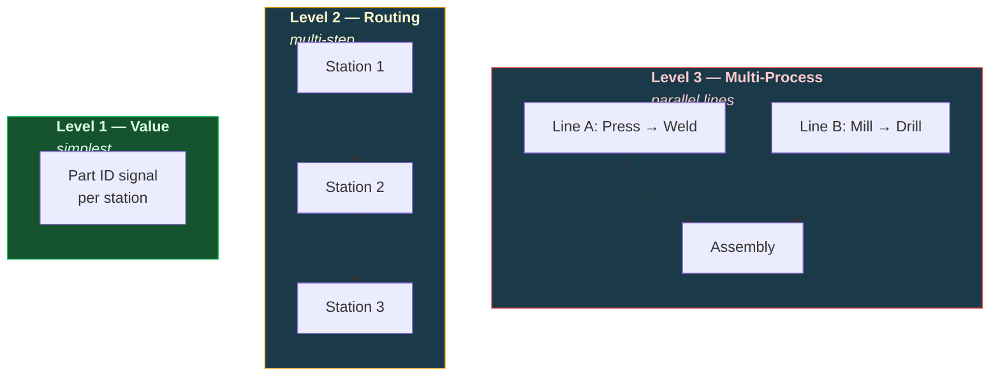
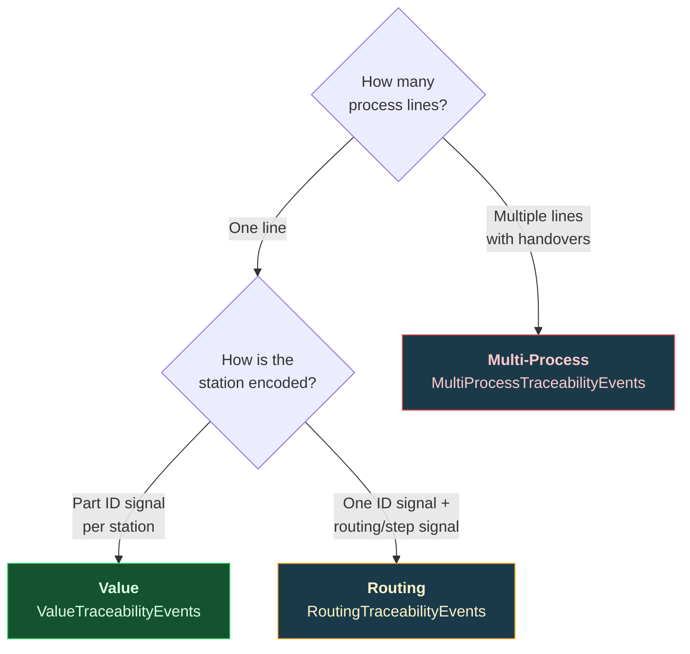

# Product Traceability

Track parts through stations that each log the part ID, multi-step routings, or parallel process lines. Three classes provide increasing levels of traceability complexity.

---

## Traceability Levels



| Class | Use When | Signals Required |
|-------|----------|-----------------|
| `ValueTraceabilityEvents` | Each station logs the part ID on its own signal | One part ID signal per station (`value_string`) |
| `RoutingTraceabilityEvents` | One part ID signal plus a routing/step signal | Part ID (`value_string`) + routing/state (`value_integer`) |
| `MultiProcessTraceabilityEvents` | Parallel cells/lines with handovers | One part ID signal per process + optional handover signals (`value_integer`) |

---

## Level 1 — Value Traceability

Each station carries its own string signal holding the part ID currently being processed. The simplest form of traceability.

```python
from ts_shape.events.production.order_traceability import ValueTraceabilityEvents

trace = ValueTraceabilityEvents(
    df,
    station_uuids={
        'station_1_part_id': 'Station 1',
        'station_2_part_id': 'Station 2',
    },
)

# Build timeline: when each part was at each station
timeline = trace.build_timeline()

# Lead time per part (first seen → last seen)
lead_times = trace.lead_time()

# Where is each part right now?
status = trace.current_status()

# Station dwell time statistics
station_stats = trace.station_dwell_statistics()
```

---

## Level 2 — Routing Traceability

Track parts through a sequential routing — correlate the part ID signal with a state/routing signal that indicates which step the part is at.

```python
from ts_shape.events.production.routing_traceability import RoutingTraceabilityEvents

trace = RoutingTraceabilityEvents(
    df,
    id_uuid='part_id_signal',
    routing_uuid='routing_step_signal',
    state_map={1: 'Loading', 2: 'Processing', 3: 'Inspection', 4: 'Unloading'},
)

# Correlate ID with routing state — full timeline
timeline = trace.build_routing_timeline()

# End-to-end lead time per item
lead_times = trace.lead_time()

# Dwell-time statistics per station/step
station_stats = trace.station_statistics()

# Routing path frequency — which sequences are most common
paths = trace.routing_paths()
```

---

## Level 3 — Multi-Process Traceability

Track parts across parallel cells or lines with handover events between them. Each process carries its own part ID signal; parallel cells that share a `station` name are grouped together.

```python
from ts_shape.events.production.multi_process_traceability import MultiProcessTraceabilityEvents

trace = MultiProcessTraceabilityEvents(
    df,
    processes=[
        {'id_uuid': 'press_part_id', 'station': 'Press'},
        {'id_uuid': 'mill_part_id', 'station': 'Mill'},
        {'id_uuid': 'assembly_part_id', 'station': 'Assembly'},
    ],
    handovers=[
        {'uuid': 'ho_press_assy', 'from_station': 'Press', 'to_station': 'Assembly'},
        {'uuid': 'ho_mill_assy', 'from_station': 'Mill', 'to_station': 'Assembly'},
    ],
)

# Full timeline across all processes
timeline = trace.build_timeline()

# End-to-end lead time across all processes
lead_times = trace.lead_time()

# Find items processed at multiple stations simultaneously
parallel = trace.parallel_activity()

# Handover events log
handover_log = trace.handover_log()

# Station dwell statistics across all processes
station_stats = trace.station_statistics()

# Routing path frequencies
paths = trace.routing_paths()
```

---

## Choosing the Right Level



---

## Module Deep Dives

**Traceability:** [Value Traceability](../modules/production/order-traceability.md) | [Routing Traceability](../modules/production/routing-traceability.md) | [Multi-Process Traceability](../modules/production/multi-process-traceability.md)

---

## Next Steps

- [Production Monitoring](production.md) — Machine states and line throughput
- [OEE & Plant Analytics](oee-analytics.md) — Batch tracking and bottleneck analysis
- [Shift Reports & KPIs](reporting.md) — Aggregate traceability data into reports
- [API Reference](../reference/index.md) — Full traceability API documentation
