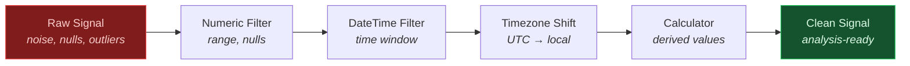

# Signal Conditioning

Clean and prepare raw plant signals before analysis. Filter noise, remove invalid readings, convert timezones, and compute derived values.

---

## Conditioning Pipeline



---

## Numeric Filtering

Remove out-of-range readings, null values, and threshold violations.

```python
from ts_shape.transform.filter.numeric_filter import DoubleFilter, IntegerFilter

# Keep values within valid sensor range (inclusive)
df = DoubleFilter.filter_value_double_between(df, "value_double", min_value=0, max_value=100)

# Remove null readings
df = DoubleFilter.filter_nan_value_double(df, "value_double")

# Integer codes, e.g. a state signal
df = IntegerFilter.filter_value_integer_between(df, "value_integer", min_value=1, max_value=4)

# Anything else: plain pandas
df = df[df["value_double"] > 50]
```

---

## Time Range Filtering

Isolate data to specific production periods, shifts, or analysis windows.

```python
from ts_shape.transform.filter.datetime_filter import DateTimeFilter

# Filter to specific production period (naive bounds use the column's tz)
df = DateTimeFilter.filter_between_dates(
    df, "systime", "2024-01-01", "2024-01-31", inclusive="both"
)

# Keep only data after commissioning date
df = DateTimeFilter.filter_after_date(df, "systime", "2024-06-01")

# Down to the second
df = DateTimeFilter.filter_between_datetimes(
    df, "systime", "2024-06-03 06:00:00", "2024-06-03 22:00:00"
)

# Production hours only: plain pandas on the hour
df = df[df["systime"].dt.hour.between(6, 21)]
```

---

## String Pattern Filtering

Filter signals by UUID, machine name, or any string column.

```python
from ts_shape.transform.filter.string_filter import StringFilter

# Single signal
df = StringFilter.filter_value_string_match(df, "temperature", column_name="uuid")

# Pattern match (all sensors on line 1)
df = StringFilter.filter_string_contains(df, "line_1_", column_name="uuid")

# Specific signal list: plain pandas
df = df[df["uuid"].isin(["temp_1", "temp_2", "temp_3"])]
```

---

## Boolean Flag Filtering

Filter by delta/absolute flags or any boolean column.

```python
from ts_shape.transform.filter.boolean_filter import IsDeltaFilter

# Keep only delta (incremental) values
df = IsDeltaFilter.filter_is_delta_true(df)

# Keep only absolute (snapshot) values
df = IsDeltaFilter.filter_is_delta_false(df)
```

---

## Timezone Conversion

Convert between UTC (historian) and local plant time.

```python
from ts_shape.transform.time_functions.timezone_shift import TimezoneShift
from ts_shape.transform.time_functions.timestamp_converter import TimestampConverter

# Convert Unix timestamps to datetime
df = TimestampConverter.convert_to_datetime(
    df, columns=["systime"], unit="ns", timezone="UTC"
)

# Shift to plant local time
df = TimezoneShift.shift_timezone(
    df, time_column="systime",
    input_timezone="UTC",
    target_timezone="Europe/Berlin"
)
```

---

## Derived Calculations

Compute rolling averages, differences, and normalized values.

```python
from ts_shape.transform.calculator.numeric_calc import IntegerCalc

# Raw counts to engineering units: value * 0.1 + 4
df = IntegerCalc.scale_column(df, "value_integer", factor=0.1)
df = IntegerCalc.offset_column(df, "value_integer", offset_value=4)

# Rolling average and rate of change: plain pandas, per signal
g = df.sort_values("systime").groupby("uuid")["value_double"]
df["rolling_mean"] = g.transform(lambda s: s.rolling(10, min_periods=1).mean())
df["diff"] = g.diff()
```

---

## Custom Filtering with Query Syntax

Combine multiple conditions using pandas query syntax.

```python
from ts_shape.transform.filter.custom_filter import CustomFilter

# Multi-condition filter
df = CustomFilter.filter_custom_conditions(
    df, "value_double > 50 and value_double < 100 and uuid == 'temperature'"
)
```

---

## Lambda Processing

Apply arbitrary transformations to any column.

```python
from ts_shape.transform.functions.lambda_func import LambdaProcessor
import numpy as np

# Log transform
df = LambdaProcessor.apply_function(df, "value_double", lambda x: np.log1p(x))

# Z-score normalization
df = LambdaProcessor.apply_function(
    df, "value_double", lambda x: (x - x.mean()) / x.std()
)

# Clip to valid operating range
df = LambdaProcessor.apply_function(df, "value_double", lambda x: np.clip(x, 0, 100))
```

---

## Module Deep Dives

**Energy:** [Consumption Analysis](../modules/energy/consumption-analysis.md) | [Efficiency Tracking](../modules/energy/efficiency-tracking.md)

**Maintenance:** [Degradation Detection](../modules/maintenance/degradation-detection.md) | [Failure Prediction](../modules/maintenance/failure-prediction.md) | [Vibration Analysis](../modules/maintenance/vibration-analysis.md)

---

## Next Steps

- [Signal Analytics](statistics.md) — Compute statistics on conditioned signals
- [Quality Control & SPC](quality.md) — Detect outliers and process shifts
- [API Reference](../reference/index.md) — Full transform API documentation
